# OpenNOW for Decky Loader

Play GeForce NOW on your Steam Deck from Game Mode. The OpenNOW plugin for [Decky Loader](https://decky.xyz) installs the OpenNOW app for you, adds GeForce NOW games to your Steam library, and starts them with Steam's own Play button.

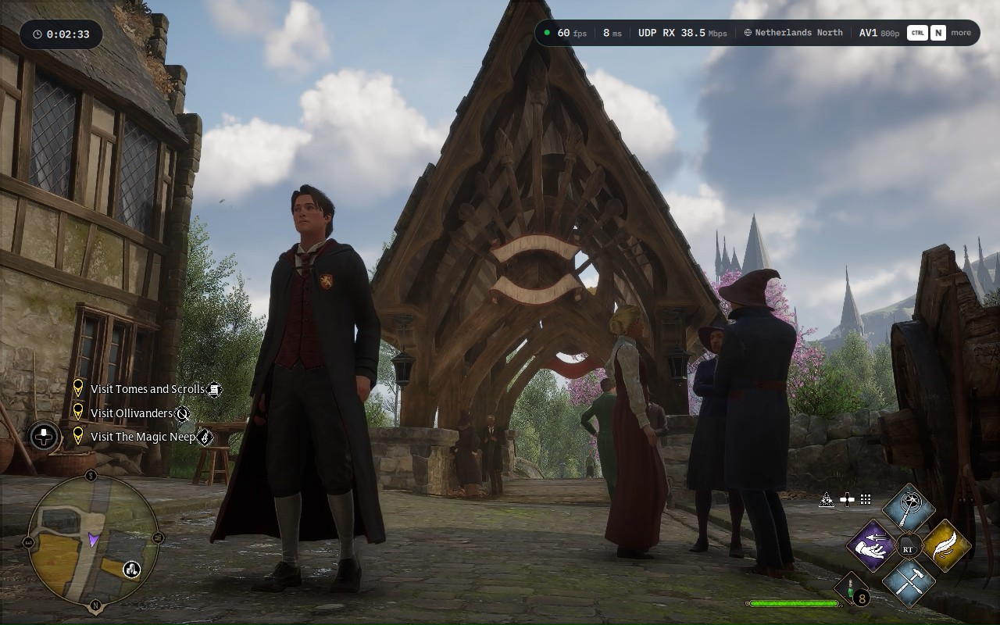

## Install

You need a Steam Deck (or another SteamOS device), an internet connection, and a GeForce NOW account. Installing or updating OpenNOW also requires host OpenSSL 3.0 or later with Ed25519 support. The plugin isn't in the Decky Plugin Store yet, so you install it from a link.

### 1. Install Decky Loader

Skip this step if Decky Loader is already on your Deck.

1. Press the **Steam** button, then choose **Power → Switch to Desktop**.
2. If you've never set a password for the `deck` user, open **Konsole**, run `passwd` and choose one. The Decky installer asks for it.
3. Open a web browser, go to [decky.xyz](https://decky.xyz) and download the installer.
4. Run the downloaded `decky_installer.desktop`. If the browser can't open it, open it from the **Downloads** folder in Dolphin.
5. Choose the **release** version and enter your password when asked.
6. Double-click **Return to Gaming Mode** on the desktop.

### 2. Install the OpenNOW plugin

1. Press the **⋯** (Quick Access) button and open the **plug** tab. That's Decky.
2. Select the **gear** icon to open Decky's settings.
3. Under **General**, turn on **Developer mode**. A **Developer** tab appears.
4. Open **Developer**, select **Install Plugin from URL** and enter:

   ```
   https://github.com/OpenCloudGaming/OpenNOW/releases/download/decky-v0.1.1/OpenNOW.zip
   ```

5. Confirm the install. **OpenNOW** now shows up in Decky's plugin list.

Newer plugin versions are published as their own releases. The [release list](https://github.com/OpenCloudGaming/OpenNOW/releases) shows them as **OpenNOW Decky plugin**.

### 3. Install OpenNOW and sign in

1. Open **⋯ → plug tab → OpenNOW**.
2. Select **Install OpenNOW** for the stable release, or **Install nightly** for the newest build. The plugin downloads the official Flatpak from GitHub, so you don't need Desktop Mode. You can switch channels later under **Install → Nightly builds**.
3. Select **Launch OpenNOW** and sign in with your NVIDIA account. After that, the panel shows you as signed in.

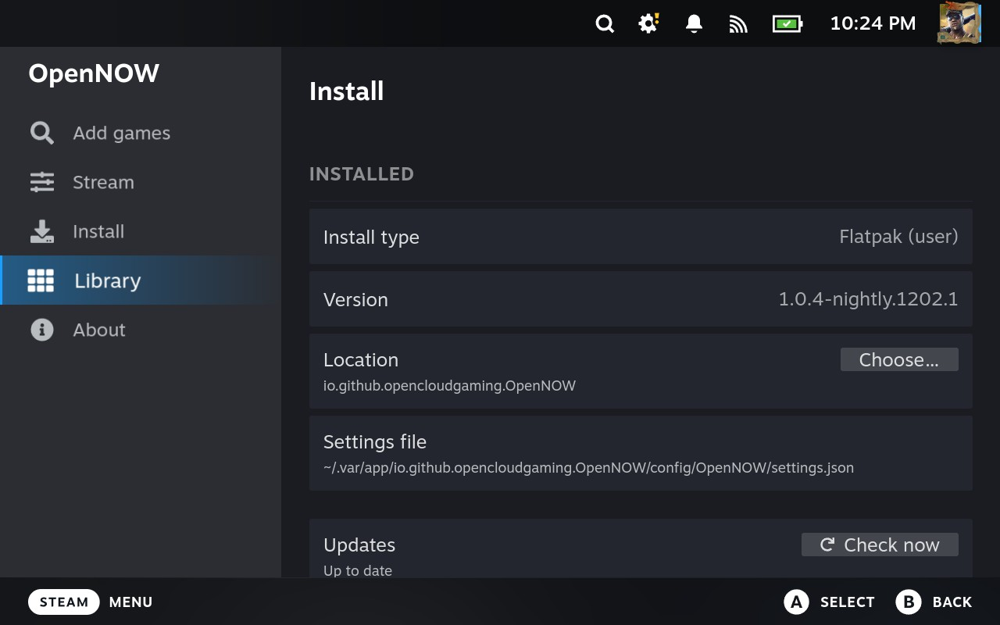

## Use it

### Add games

Open the plugin's full-screen page and choose **Add games**. Search the GeForce NOW catalog, pick the store you own the game on, and select **Add to Library**. The game shows up in your Steam library with its artwork and in an **OpenNOW** collection.

| Search the catalog | Added to your library |
| --- | --- |
| 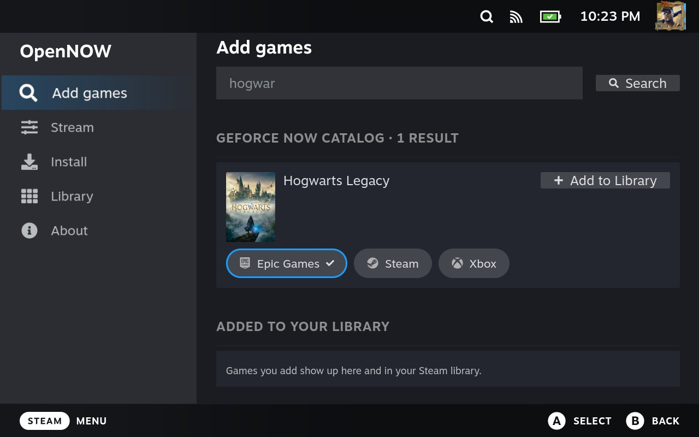 | 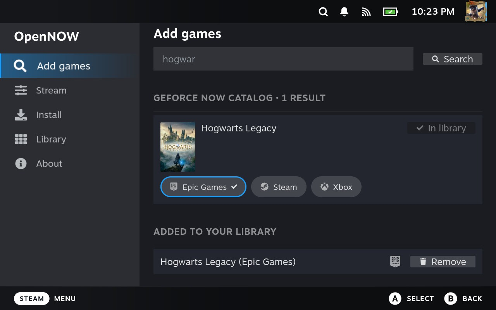 |

| Steam library | OpenNOW collection |
| --- | --- |
| 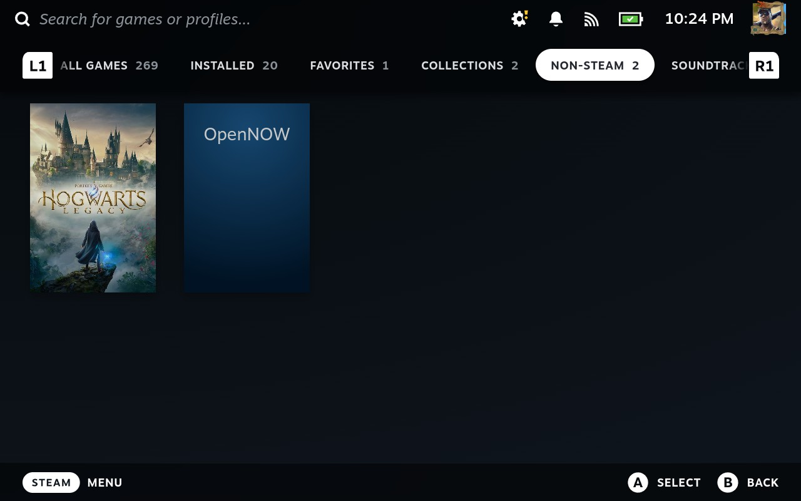 | 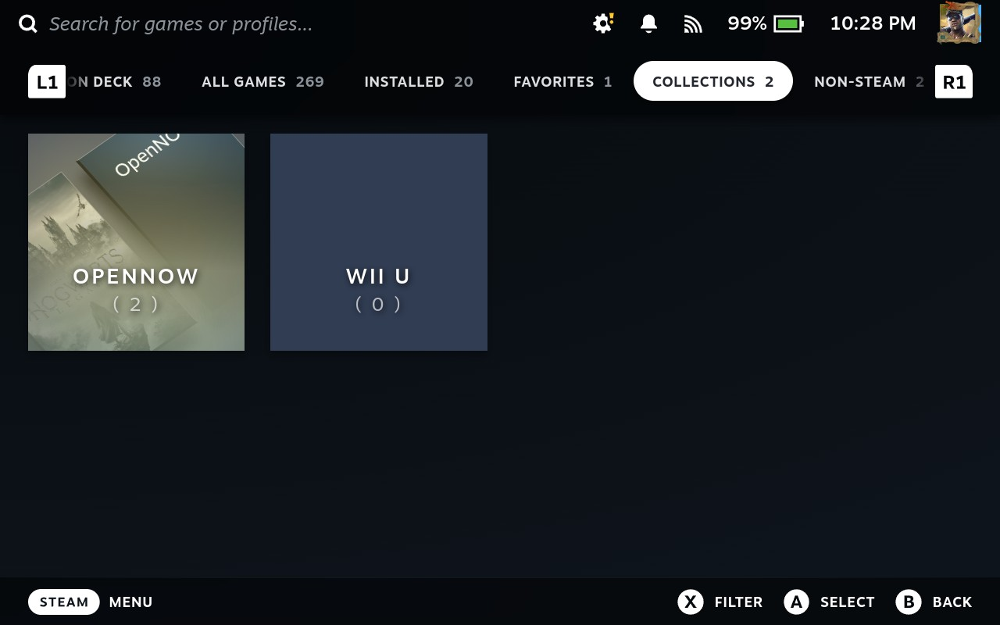 |

### Play

Press **Play** on a game you added. OpenNOW opens full screen, requests a rig and goes straight into the game. When the session ends, OpenNOW closes and you're back in Steam.

For Steam games that are also on GeForce NOW, the game's page gets a **Play on OpenNOW** button next to Steam's Install or Play button.

| Game page | Starting a session |
| --- | --- |
| 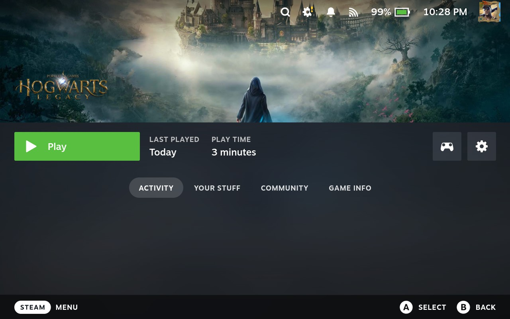 | 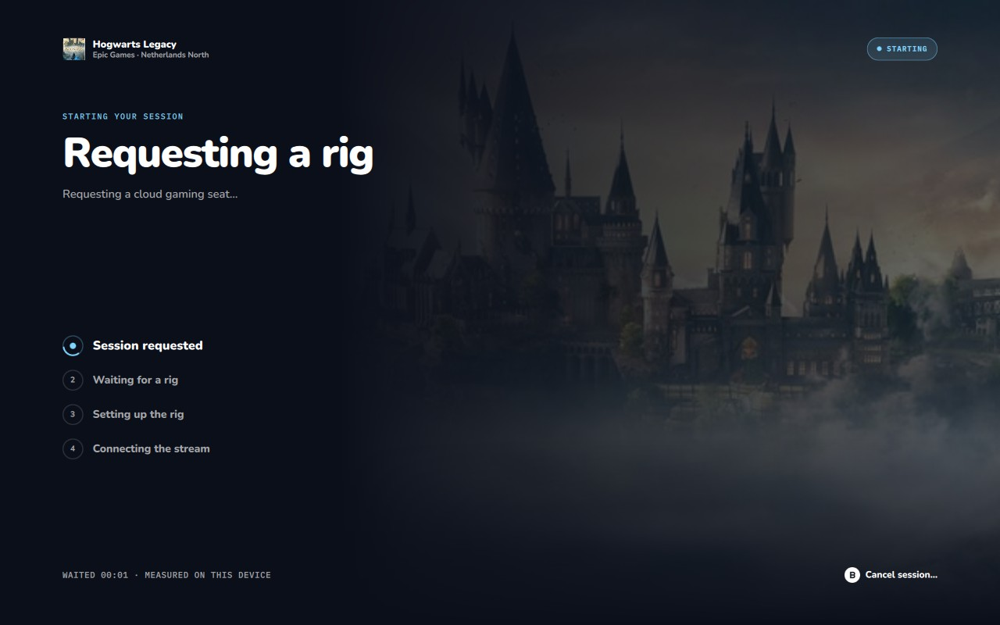 |

### During a session

Press **View** and **Menu** together to open the session menu (OpenNOW 1.0.4 nightlies and later). From there you can take a screenshot, show stats, manage controllers or end the session. The game doesn't receive the button press.

| Session menu | Ending a session |
| --- | --- |
| 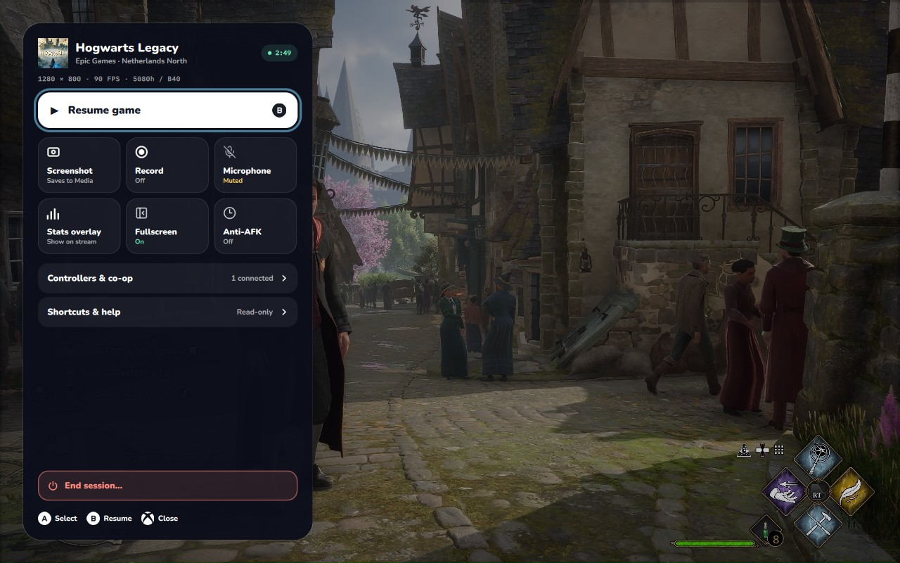 | 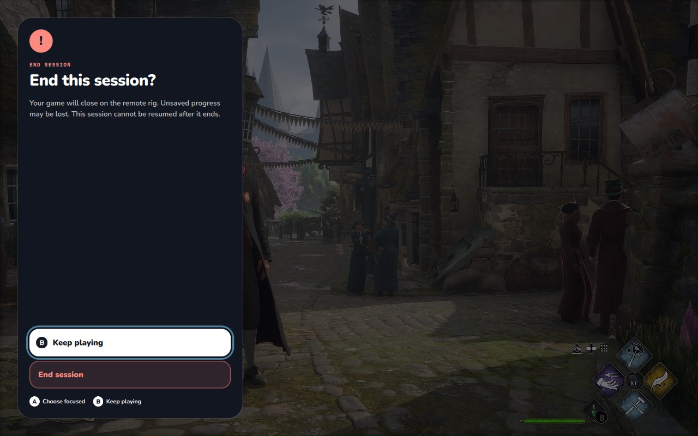 |

### Stream settings

The **Stream** page sets resolution, frame rate, bitrate, codec and HDR. Under **Device**, **Steam Deck identity** tells GeForce NOW the device is a Steam Deck, which unlocks 90 fps. OpenNOW turns it on automatically the first time it runs on a Deck. Settings are read-only while OpenNOW is running.

| Picture | Device |
| --- | --- |
| 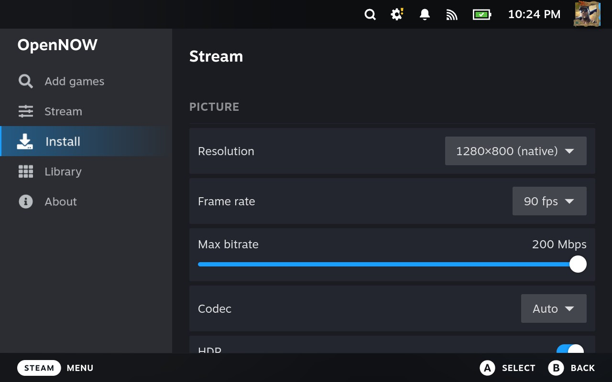 | 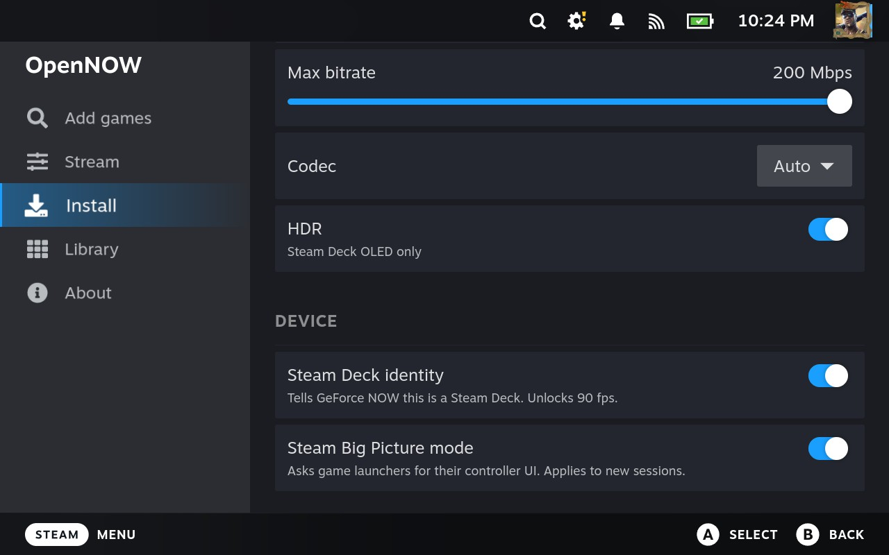 |

## Troubleshooting

- **The plugin doesn't appear after installing.** Open Decky's settings and select **Restart Decky** under **General**, or restart the Deck.
- **OpenNOW asks you to sign in every time.** Update to the newest OpenNOW. On a Steam Deck, OpenNOW saves your sign-in to a file instead of the desktop keyring, which stays locked in Game Mode.
- **On DroidDeck, Install OpenNOW says to set up Flatpak.** Set up Flatpak from DroidDeck's Store, then select **Install OpenNOW** again. The plugin installs the ARM64 build through DroidDeck's Flatpak helper. The first install also downloads the KDE runtime, which can take a while.
- **OpenNOW installation reports a signature or OpenSSL error.** The plugin verifies stable and nightly Flatpaks against the production Ed25519 key before running either Flatpak installer. Missing manifests, invalid signatures, mismatched downloads, and unavailable or incompatible host OpenSSL stop installation. Update the plugin and your host OS; do not bypass verification.
- **An old version of OpenNOW starts.** Close every OpenNOW window, including any left open in Desktop Mode, then launch it again. The plugin only uses the copies listed under [How it finds OpenNOW](#how-it-finds-opennow).

## How it finds OpenNOW

The plugin checks these locations in order:

1. A path you chose under **Install → Location**.
2. The Flatpak `io.github.opencloudgaming.OpenNOW`, user installation first, then system. On DroidDeck, the plugin starts it through `droiddeck-flatpak-run`, so the window opens in gamescope.
3. On DroidDeck, the newest OpenNOW AppImage imported through DroidDeck, under `/opt/appimages/user`.
4. The newest `OpenNOW*.AppImage` in `~/Applications`, `~/AppImages`, `~/Downloads`, `~/Desktop`, `~/.local/bin` or `~`.
5. `/usr/bin/opennow-qt` from the `.deb`.

Stream settings go to the same `settings.json` that the app reads. That file is `~/.var/app/io.github.opencloudgaming.OpenNOW/config/OpenNOW` for the Flatpak and `~/.config/OpenNOW` for other installs. OpenNOW's core owns the file while the app runs, and the plugin detects this through the core's `core.lock` in `/proc/locks`. The plugin writes the file the same way the core does: an atomic replace that keeps a `.bak` copy, and every key the plugin doesn't edit stays untouched.

Game Mode only shows apps that Steam starts, so the plugin always launches OpenNOW through Steam shortcuts. **Play on OpenNOW** reuses the plugin's OpenNOW shortcut and passes the game to it, so it doesn't add a shortcut per game.

## Develop

Requirements: Node.js 22, Python 3.11, and host OpenSSL 3.0 or later with Ed25519 support. Run all commands from `decky/`.

```sh
npx pnpm@9 install
npx pnpm@9 run typecheck
npx pnpm@9 run build
npx pnpm@9 run test
npx pnpm@9 run package   # writes out/OpenNOW.zip
```

To install a build on a device, copy `out/OpenNOW.zip` to the device. Then install it from Decky's settings: **Developer → Install plugin from ZIP file**.

Releases are published by `decky.yml`. When a push to `dev` changes `decky/` and `package.json` has a version that isn't released yet, it publishes a `decky-v<version>` prerelease with `OpenNOW.zip`. Releases are immutable, so bump `version` in `package.json` to publish a new build, then update the install link above.

The backend lives in `main.py`. Its logic lives in `py_modules/opennow_decky`, which has no Decky dependency, so `tests/` exercises it directly. The frontend in `src/` uses Steam's own components from `@decky/ui`.
